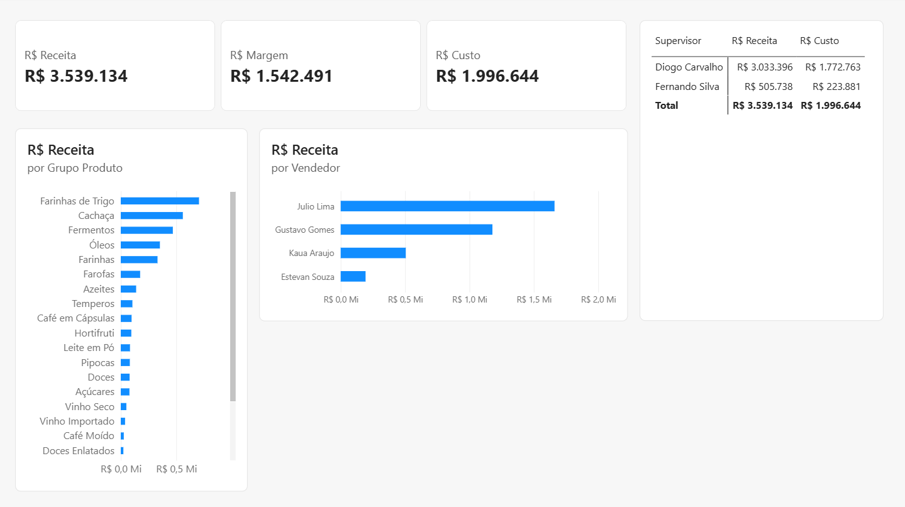

# 📊 Dashboard de Análise de Vendas | Power BI

## 📌 Sobre o projeto

Este projeto tem como objetivo analisar o desempenho de vendas entre os anos de 2021 e 2023, utilizando o Power BI para transformar dados em informações visuais que facilitam o acompanhamento dos resultados e a identificação de padrões de vendas.

O dashboard permite explorar o faturamento, a quantidade vendida e o desempenho das categorias de produtos ao longo do período analisado.

## 🎯 Objetivos da análise

- Acompanhar o faturamento total das vendas.
- Analisar a evolução do faturamento ao longo do tempo.
- Identificar as categorias de produtos com melhor desempenho.
- Consultar informações de vendas por produto.
- Comparar a quantidade vendida e o valor das vendas.

## 📈 Indicadores e visualizações

O dashboard apresenta os seguintes recursos:

- **Faturamento total:** visão geral do valor faturado no período.
- **Filtro de data:** permite selecionar o período desejado para análise.
- **Filtro por produto:** facilita a consulta de produtos específicos.
- **Faturamento ao longo do tempo:** gráfico para acompanhar a evolução das vendas.
- **Categoria de produto:** permite analisar os resultados por categoria.
- **Quantidade vendida:** acompanhamento do volume de produtos vendidos.
- **Valor da venda:** consulta dos valores associados às vendas.
- **Ranking por categoria:** comparação das categorias de produtos de acordo com seu desempenho.

## 🛠️ Ferramentas utilizadas

- Power BI
- Power Query
- Excel / CSV (base de dados)

## 🔎 Principais análises

A partir do dashboard, é possível investigar tendências de faturamento, comparar o desempenho das categorias e identificar produtos que contribuem para os resultados de vendas.

Os filtros interativos permitem aprofundar a análise por período e produto, facilitando a exploração dos dados e a obtenção de insights.

## 📅 Período analisado

2021 a 2023.

## 🚀 Aprendizados

Este projeto contribuiu para a prática de preparação e organização de dados, criação de indicadores e desenvolvimento de visualizações interativas no Power BI, com foco na análise de desempenho comercial.

## 📂 Arquivos do projeto

- `FarmaDash.pbix`: arquivo do projeto Power BI.
- `farmacia_vendas.csv`: base de dados utilizada na análise. *(Inclua se puder compartilhar a base.)*
- `README.md`: documentação do projeto.

## 👨‍💻 Autor

**Nicolas Lima**

- LinkedIn: [linkedin.com/in/nicolaslimadev](https://www.linkedin.com/in/nicolaslimadev/)
- GitHub: [github.com/nicolaslimadev](https://github.com/nicolaslimadev)